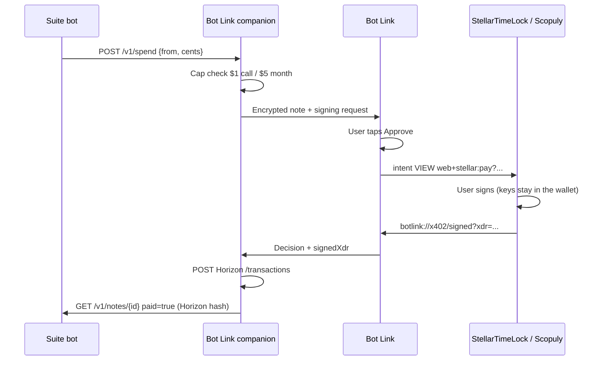

# Bot Link x402 signing request (for Scopuly)

Bot Link never holds Stellar keys. A spend that is inside the cap ($1 a call, $5 an agent each month) becomes an **x402 v2 `exact`** challenge plus a **SEP-7** URI. StellarTimeLock signs on the phone via `web+stellar:` intent. Scopuly can open the same URI or the same JSON.

Protocol version: **`botlink.x402.sep7` v1**, wrapping **x402 v2**.

## Flow



No polling. The companion answers when asked. The phone opens the wallet only after Approve.

## Exact payload

This is the signing request for **40 cents (0.40 USDC)** on pubnet. `payTo` below is the x402 spec **example** address, not a real account. Set the live destination with `--pay-to` / `BOTLINK_X402_PAY_TO` / `payTo` in `StellarTimeLock/backups/Bot Link/botlink.local.json`.

Field names inside `paymentRequired` match Scopuly’s live `PAYMENT-REQUIRED` header (`x402Version`, `resource`, `accepts[]`, `error`).

```json
{
  "v": 1,
  "protocol": "botlink.x402.sep7",
  "x402Version": 2,
  "paymentRequired": {
    "x402Version": 2,
    "resource": {
      "url": "botlink://spend/11111111-1111-1111-1111-111111111111",
      "description": "Bot Link agent spend",
      "mimeType": "application/json",
      "serviceName": "Bot Link",
      "tags": ["stellar", "x402", "usdc"]
    },
    "accepts": [
      {
        "scheme": "exact",
        "network": "stellar:pubnet",
        "asset": "CCW67TSZV3SSS2HXMBQ5JFGCKJNXKZM7UQUWUZPUTHXSTZLEO7SJMI75",
        "amount": "4000000",
        "payTo": "GBHEGW3KWOY2OFH767EDALFGCUTBOEVBDQMCKU4APMDLQNBW5QV3W3KO",
        "maxTimeoutSeconds": 300,
        "extra": {
          "areFeesSponsored": true,
          "cents": 40,
          "agent": "grok-bot"
        }
      }
    ],
    "error": "Payment required"
  },
  "sep7": "web+stellar:pay?destination=GBHEGW3KWOY2OFH767EDALFGCUTBOEVBDQMCKU4APMDLQNBW5QV3W3KO&amount=0.4000000&asset_code=USDC&asset_issuer=GA5ZSEJYB37JRC5AVCIA5MOP4RHTM335X2KGX3IHOJAPP5RE34K4KZVN&memo=bl%3A11111111&msg=Bot%20Link%20spend%20%240.40&origin_domain=stellartimelock.com&callback=url%3Abotlink%3A%2F%2Fx402%2Fsigned",
  "callback": "botlink://x402/signed",
  "walletPackage": "com.stellartimelock"
}
```

- `amount` is USDC atomic units (7 decimals). 40 cents = `4000000`.
- `asset` is official Stellar USDC (`CCW67…MI75` pubnet, `CBIELT…DAMA` testnet).
- SEP-7 operation is `pay`. Callback is `url:botlink://x402/signed`.
- After the wallet signs, the companion POSTs `signedXdr` to Horizon (`https://horizon.stellar.org/transactions`, or testnet). `paid: true` and `txHash` are set only when Horizon accepts. The signed XDR is the x402 `PaymentPayload.payload.transaction`.
- Live `/v1/spend` requires a real house G-address (`--pay-to` / `BOTLINK_X402_PAY_TO`). The spec example `payTo` below is for this document and tests. The companion refuses it unless `BOTLINK_X402_ALLOW_EXAMPLE=1`.

## What Scopuly should do

1. Parse `protocol` = `botlink.x402.sep7` and `x402Version` = `2`.
2. Take `paymentRequired.accepts[0]` as the exact requirement (`scheme=exact`, `network=stellar:pubnet`).
3. Open `sep7` (or rebuild a SEP-7 / auth-entry sign from that requirement).
4. Return the signed XDR to `callback`. Do not send keys.

Scopuly’s public-beta Mainnet wallet cap is currently 0.1 USDC. A $1 Bot Link spend is over that cap; use StellarTimeLock or testnet (`BOTLINK_X402_NETWORK=stellar:testnet`) for larger amounts.

## Companion

```http
POST http://127.0.0.1:18765/v1/spend
{"from":"grok-bot","cents":40,"reason":"lookup","payTo":"G..."}
```

Saves live under `StellarTimeLock/backups/Bot Link/` (`botlink.local.json`, `botlink-spend.json`).
